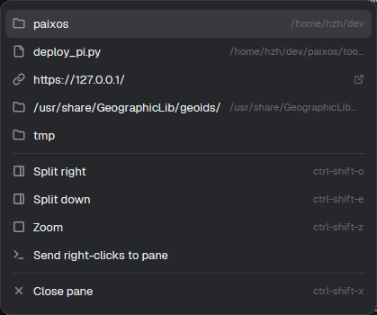

# Menu links

在终端右键菜单顶部列出当前屏幕上的链接：URL、绝对路径、`~/` 和相对路径。指向 WSL 的路径会在 WSL 里校验存在，点击后经 `wslpath -w` 交给 Windows 的资源管理器；URL 用 `rundll32` 打开。Herdr 原生的 Ctrl+点击只认本机存在的路径，WSL 终端里的 `/home/...` 点不开，这个菜单是一个替代入口。

这份文件是 brief：从空文件夹重新构建所需的信息。旁边的文件是一份实现。

## 你会看到

- 右键终端（程序接管鼠标时用 Shift+右键）打开的菜单顶部多出一组链接，和 Herdr 原来的 Split / Zoom / Close 之间有一条分隔线。
- 每行左边是图标：URL 用链接图标，文件夹/文件用文件夹/文件图标。中间是文件名或 URL，右边是所在目录；URL 行右侧是一个外链图标，没有文字。
- 右键前选中的文本如果整段就是一个链接，它会排在第一行。
- 最多 6 条，按屏幕位置从下到上（最新输出在前）。没有链接时，菜单和 Herdr 原来的一样。
- 菜单 420×460，使用主题的 `popover`、`foreground`、`muted`、`dim`、`hover`、`selected` 颜色。

## 它怎么工作

- 只对**另一台机器**（WSL）上的终端生效；本机终端的链接交给 Herdr 自己，菜单保持原样。
- `hc get <terminal> --json` 取终端的 `cwd`；`hc read <terminal> --json` 取当前屏幕文本（不含回滚历史）。
- `links.js` 按 Ghostty 的链接规则提取候选：
  - URL：`https?`、`ftp`、`ssh`、`mailto`、`tel`、`magnet` 等；`https://{host}{uri}`、`https://<host>/x`、`https://$HOST/x` 这类模板会被过滤；带 `//` 的协议必须有主机。
  - 路径：`/绝对`、`~/`、带目录和扩展名的相对路径；去掉 `:12`、`:12:7`、`:70-150` 行号；`file:///...` 转成路径。
  - 同一个 URL/路径只留一条；Markdown 的 `[文字](链接)` 会先抠出目标。
- `~/` 用远端的 `$HOME` 展开，相对路径用终端 `cwd` 补齐，然后在那边**一次** `sh` 批量 `test -e`：只留下存在的路径，并区分文件夹/文件。
- 点击：
  - 路径 → `wslpath -w` → `/mnt/c/Windows/explorer.exe`；
  - URL → `/mnt/c/Windows/System32/rundll32.exe url.dll,FileProtocolHandler`。不用 `explorer.exe`，因为它会把 URL 里的 `=` 当成自己的参数。
  - 失败时 `notify` 一条错误。`explorer.exe` 成功时也可能返回 1，所以成功与否不按它的退出码判断。
- 一屏最多 6 条；选中的链接优先，并占其中一条。

## 由什么组成

- 一个 mod，`mods/menu-links/`：
  - `main.js`：菜单、`hc` 读取、存在性检查、打开动作；
  - `links.js`：纯函数，识别/去重/补路径；
  - `link.svg`、`external-link.svg`：链接图标；
  - `mod.json`：`place: "none"`，overlay 420×460。
- 它是 shipped `menu` 的克隆（`mod.clone`），所以保留了 Herdr 的原菜单项。Herdr 升级后，原菜单项不会自动跟进；需要重新克隆，或手动把新的原菜单项合进来。`MAX_LINKS` 在 `main.js` 顶部。
- 布局根节点：`"terminal_menu": "menu-links"`。没有 `keys.json`，不需要按键。
- 用到 `herdr` 的 `props()`（`target.terminal` 是右键的那个终端）、`terminals()`、`panes()`、`spaces()`、`hc()`、`exec({ on: machine })`、`notify()`、`theme()`、`window()`、`run()`。
- 只调用 Herdr 和 core，不联网；`exec` 在终端所在的机器上运行。

## 注意

- Herdr 的 Ctrl+点击仍然不会打开 WSL 路径：Windows 上的 app 先在本机做 `exists()`，再 `ShellExecuteW`（`src/links.rs`）；mods 也拿不到链接触击（#228 / #412 尚未合并）。这个菜单是替代入口，不是真正的左键点击。
- OMP、Claude Code 这类接管鼠标的程序，普通右键会进程序；用 **Shift+右键** 打开菜单，或在菜单里选 “Use Herdr right-click menu”。
- 只读当前屏幕；全屏 TUI 没有回滚，滚出去的链接看不到。
- 路径里带空格时会被按空白拆开，可能识别不到整条路径。
- `https://example.com/{id}` 这种模板 URL 会被当成不稳定地址过滤。
- ssh 会话里没有 Windows 的 PATH，所以 opener 用 `/mnt/c/Windows/...` 绝对路径；Windows 装在别的盘时改 `main.js` 里的 `W`。
- 非 WSL 的远程 Linux 机器会退回 `xdg-open`，通常没有本地显示，什么也不会发生。
- 仓库里的 `preview.png` 是实际运行截图；链接取决于当时终端屏幕上的内容。

## 完成标准

- `herdr-app check mods/menu-links` 通过。
- 在 WSL 机器的终端里打印 `https://example.com` 和一个存在的路径（如 `~`），右键（或 Shift+右键）能看到链接行；点 URL 打开 Windows 默认浏览器，点路径打开资源管理器/关联程序。
- 不存在的路径、`https://{host}{uri}` 不会出现在菜单里。
- 选中一段链接再右键，它排在第一行；点击后正常打开。
- 本机 Windows 终端的菜单保持 Herdr 原来的样子，没有链接组。
- Split right / Split down / Zoom / Close pane 等原菜单项仍然工作。
